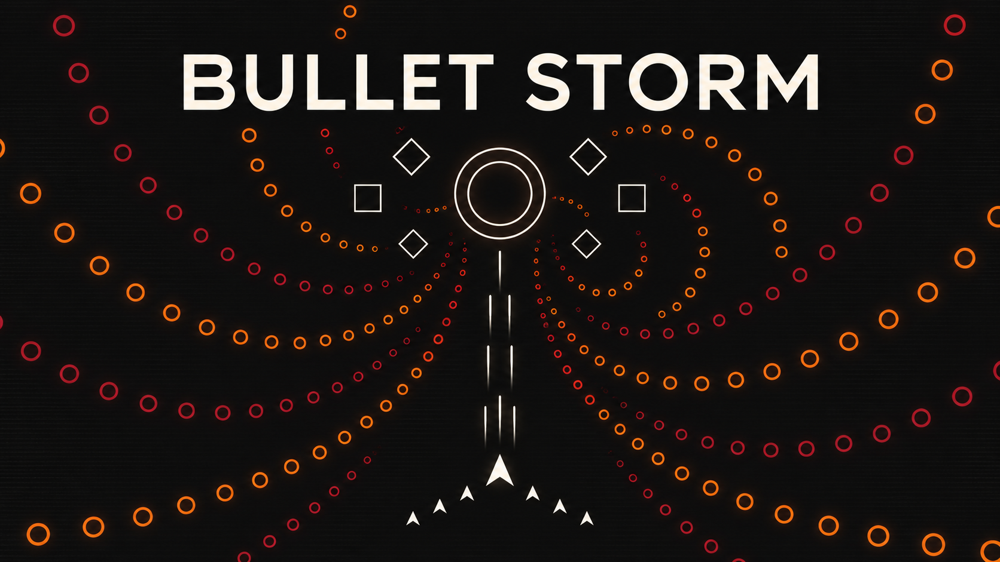

# Bullet Storm

A minimalist endless bullet-hell shooter. Dodge, collect wingmen, and survive rising difficulty.

[Play in your browser](https://eric-schecter.github.io/bullet-storm/)

## Controls

- **WASD / arrows:** Move.
- **Space / left mouse:** Fire.
- **Shift:** Move slowly for precise dodging.
- **Esc:** Pause.

Collect drops from heavy enemies to gain up to six wingmen. Hits remove a wingman first; your main weapon keeps its upgrades.

## Run locally

Open `project.godot` in Godot **4.7.2**, or run `godot --path .`.

Export the web build with `./tools/export_web.sh` (Godot and its matching web export template required).

Cover, music, and some effects were generated with AI. Combat sounds are from [Nier-Hacking](https://github.com/Eric-Schecter/Nier-Hacking); see [asset credits](assets/CREDITS.md).
